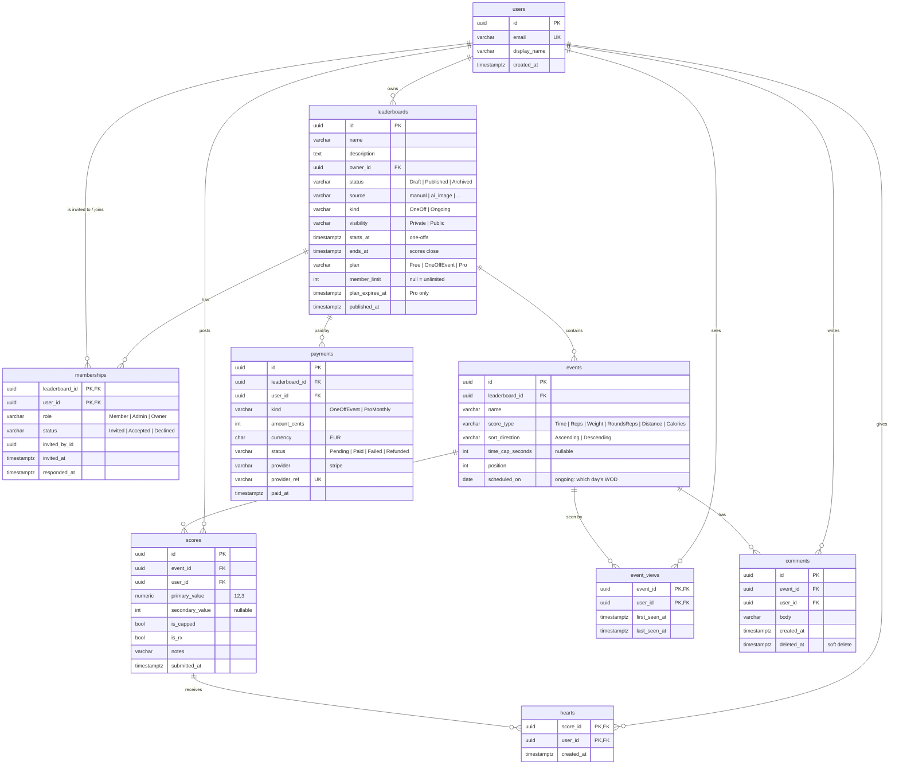

# Data model

Postgres, 9 tables. Table and column names are `snake_case`. Ids are UUID v7, which are time-ordered so they index well. Enums are stored as short text (`'Time'`, `'Accepted'`) so rows read clearly in any SQL viewer. The full DDL is in [schema.sql](schema.sql), generated from the EF Core migration.

## The tables in one line each

- **users**: an account. Email is unique.
- **leaderboards**: a board such as "Friday Hyrox sim". It starts as a `Draft`, which only its admins can see and edit, and becomes `Published` when it's ready. `source` records whether it was typed in or AI-imported.
- **memberships**: one row per (board, user). **This is also the invite.** An admin inserts it as `Invited`, and the invitee flips it to `Accepted` or `Declined`. The creator gets an `Owner` row automatically. `Admin` and `Owner` are the roles that "see all".
- **events**: one workout or station on a board, such as "1km SkiErg", "Fran" or "AMRAP 12". It carries the score type and sort direction.
- **scores**: one per user per event (unique index). Re-submitting updates it.
- **event_views**: "seen by". One row per person who has viewed an event's unlocked results.
- **hearts**: a like on a score. The composite key makes double-liking impossible.
- **comments**: a flat comment list per event. It's soft-deleted so threads don't lose context.
- **payments**: one row per payment attempt for a board, with no card details stored. The provider's id is kept for matching up webhooks.

## Board kinds, visibility and plans

These are three separate settings on a board, so any combination works. A private one-off comp for your gym is fine, and so is a public daily-WOD board.

**Kind** (`kind`):
- **`OneOff`** is a dated event such as a half marathon or a one-day throwdown. It needs `starts_at`. Scores close at `ends_at`, which defaults to two days after the start so late entries can still come in. After that, members can't post but admins can still correct scores. A finished comp drops out of public search but stays in members' lists as a results page.
- **`Ongoing`** never ends, like a gym's daily class. Events are added over time, each with `scheduled_on` (the day's WOD), and the app lists the newest day first. An ongoing board can be published empty and filled day by day.

**Visibility** (`visibility`):
- **`Private`**: invite-only, the flow you already have.
- **`Public`**: listed in `GET /leaderboards/public`, and anyone taps **Join**, which creates an `Accepted` membership directly. Admins can still invite people to a public board. Results stay hidden until you post on public boards too.

**Plan and limits** (`plan`, `member_limit`). Prices and limits live in `appsettings.json` under `Plans`, not in code:

| Plan | When | Member limit | Price (placeholder) |
|---|---|---|---|
| `Free` private | default | **15** (`FreePrivateMemberLimit`) | free |
| `Free` public | default | unlimited (`FreePublicMemberLimit`) | free |
| `OneOffEvent` | one-off comps | 500 | **€20 once**, paid before publishing |
| `Pro` | upgrade for big ongoing private boards | unlimited | €9/month (placeholder) |

- The member count includes **pending invites**, so an admin can't send 50 invites to a 15-seat board. Hitting the cap returns **402 Payment Required**, which the app can turn into an "Upgrade" prompt.
- `member_limit` is copied onto the board when its plan changes instead of being looked up live. That means you can change prices later without breaking existing boards, and you can hand a friend's gym a custom limit with one SQL update.
- **One-off comps must be paid for before they're published.** Drafting, editing and AI import stay free, so people only pay once they're happy with it.

**Payments flow.** No provider is connected yet:
1. `POST /leaderboards/{id}/checkout {kind}` creates a `Pending` payment at the configured price. With Stripe, this also creates a Checkout Session and returns its URL.
2. The user pays, and the provider calls a webhook. For now, `POST /dev/payments/{id}/mark-paid` stands in for the webhook.
3. `BoardRules.ApplyPaid` marks the payment `Paid` and upgrades the board's plan and limit. It does nothing on a repeat call, because providers do send webhooks twice.

## Score types (the tricky bit)

Every score is stored as **`primary_value` (numeric) + optional `secondary_value` (int)**, and the event's `score_type` says how to read them:

| score_type   | primary_value     | secondary_value | Better is | Displayed as  |
|--------------|-------------------|-----------------|-----------|---------------|
| `Time`       | seconds (245.3)   | reps if capped  | lower     | `4:05.3`      |
| `Reps`       | reps              | –               | higher    | `150`         |
| `Weight`     | kg (102.5)        | –               | higher    | `102.5 kg`    |
| `RoundsReps` | full rounds (5)   | extra reps (12) | higher    | `5 + 12`      |
| `Distance`   | metres            | –               | higher    | `2500 m`      |
| `Calories`   | calories          | –               | higher    | `48 cal`      |

Sorting is always by `(primary, secondary)` in the event's `sort_direction`, which defaults from the type: `Time` ascends and everything else descends. It's stored per event so an odd workout such as "fewest burpees" can override it.

**Time caps:** for a `Time` event with `time_cap_seconds`, someone who doesn't finish submits `is_capped = true` with the reps they completed in `secondary_value`. Every finisher ranks above every capped athlete, and capped athletes rank by reps. The API rejects an uncapped time that's over the cap.

**Ties** share a rank (1, 2, 2, 4). All of this lives in one file, `backend/LeadersBoards.Api/Domain/ScoreRules.cs`.

Why not one column per kind (`time_ms`, `weight_kg`, `rounds`, …)? Two generic columns keep sorting and indexing uniform, and adding a type such as "Points" later is a code change, not a migration.

## "Results hidden until you post"

Enforced on the server in `Data/Access.cs → CanSeeResults`, never just hidden in the app:

> You see an event's results **if your membership is Admin or Owner, or you have a row in `scores` for that event.**

If you can't see them, `GET /events/{id}/results` returns `locked: true` plus the **count** of people who have posted, so the app can say "6 people have posted" without spoiling anything. The same rule guards seen-by, hearts and comments, because comments like "great 3:58, Sam!" would spoil the results otherwise. A view is recorded only when results are actually shown, so "seen by" means "saw the leaderboard".

## Assumptions (shout if any are wrong)

1. **One score per person per event**, editable. There's no history of attempts. If you want "best of several attempts", add an `attempts` table later.
2. **Invites are for people who already have an account.** Inviting a brand-new email (send a sign-up link) needs an `invite_email` column and an email sender, so that's for later.
3. **"Seen by" is per event**, not per board.
4. **Comments are per event**, not per score, and are a flat list with no replies.
5. **Rx/Scaled** is a single flag on the score. Scaled scores are labelled but still ranked together. Splitting them into separate leaderboards is an easy follow-up.
6. Scores are only visible to the board's members, including on public boards: you join to see them.
7. **Anyone can create a public board for free**, with no cap. If that invites spam, limit public boards to verified organisers or put them on a paid plan.
8. The **member cap applies to private boards only**, matching what you described. Paying for a one-off comp raises its cap to 500.
9. **Monthly Pro is a placeholder.** You mentioned "payment required" past the cap but not whether that's a one-off or a subscription. I'd go with a subscription, because an ongoing board keeps costing you to run.

## Later additions that fit without reworking anything

- **AI import:** the app uploads a photo, a vision model returns `{name, events[]}`, and the result fills the same "New board" form as a `Draft` with `source = 'ai_image'`. No new tables are needed.
- **Weekly recap:** a `recaps (leaderboard_id, week_start, body, created_at)` table filled by a weekly background job, plus Expo push tokens on `users`.
- **Overall standings for one-off comps:** rank everyone across all events (CrossFit-style points, where the lowest sum of placings wins). This can be computed from existing scores with no new tables.
- **Invite links / join codes for private boards:** a `join_code` column on `leaderboards`.
- **Real auth:** add `password_hash` (ASP.NET Identity), or keep `users` and link it to Supabase Auth's `auth.users.id`.
